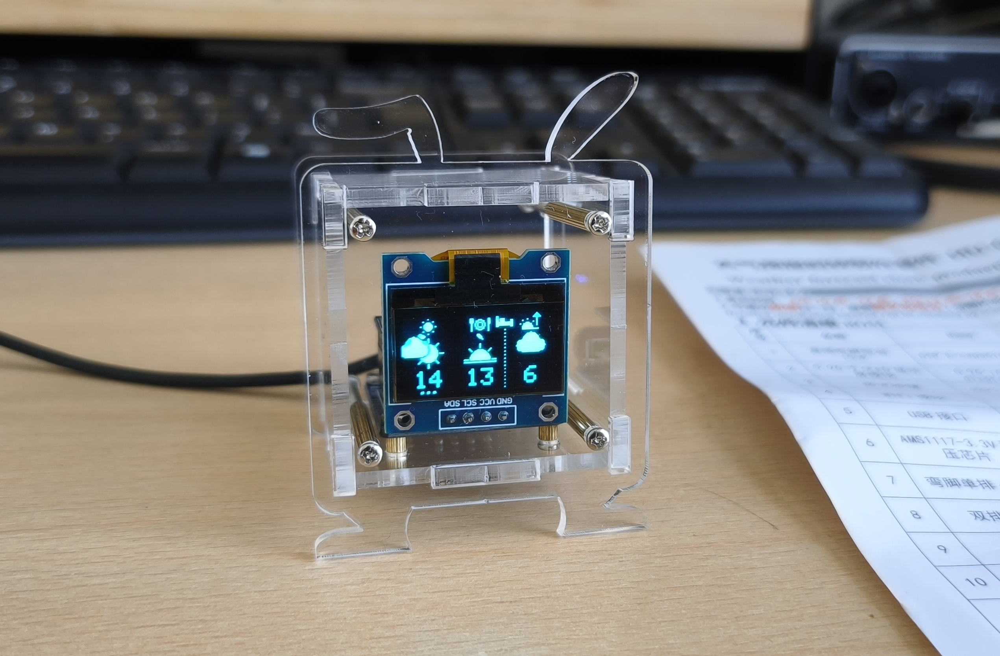
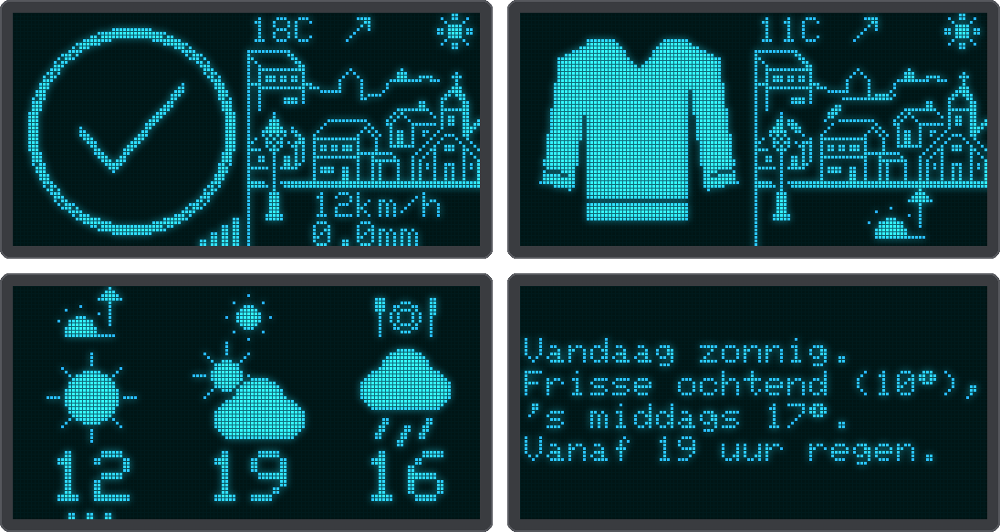
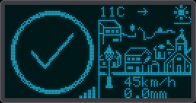
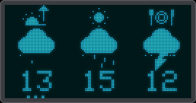
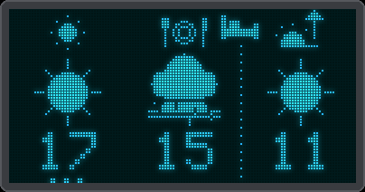
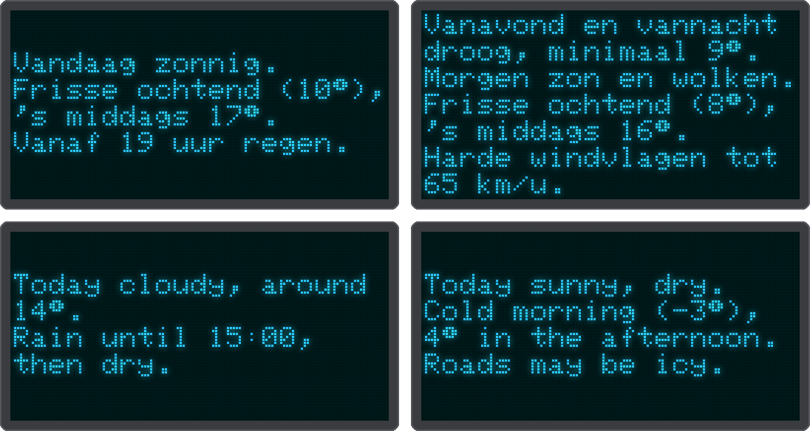

# Dayspeck

<p align="center"></p>

<p align="center"></p>

An open-source weather display for a bedside table, a hallway or a kitchen wall, built for an ESP8266 (ESP-01)
with a 0.96" 128×64 SSD1306 I²C OLED and the free Open-Meteo forecast. Dayspeck is not a fixed-purpose
weather clock: one firmware combines practical weather tools, playful picture screens and lively animations,
and you choose the mix that suits your home.

Make the display your own in its web page: choose up to six screens for taps and six for long presses, arrange
them in any order, and put your favourite in the home slot. Set a screen to return home after a while, or cycle
through your choices automatically—even without a button. Change the setup whenever you like; no rebuilding
or reflashing.

**📖 Manual: <https://martijn4313.github.io/Dayspeck/>**

## One display, your combination

| Screen | At a glance |
|--------|-------------|
| **Ride rating** | *Can I ride today?* A ✓ / ! / ✗ rating with an animated village, today or tomorrow, a 7-day ride grid, and the best time to leave |
| **Next hours and ride hours** | See rain, temperature and gusts coming up, compare the next hours, and find a good time to ride |
| **Picture screens** | Weather and what to wear for the day, shown in pictures and temperatures—no reading needed. Includes an animated village, a time-lapse of the day's weather, and countdowns to birthdays and holidays |
| **Weather report** | A few concise sentences in English or Dutch, composed on the device from forecast rules, with warnings for frost, strong gusts and heavy rain |
| **Clock and lucky cat** | The time and date, or a beckoning cat with the temperature |

Mix screens for the people and place:

- **Rider's bedside:** ride rating at home; a tap switches between today and tomorrow, and a long press opens the week, next hours and clock.
- **Family hallway:** what to wear now at home; tap through the weather and clothes, with a long press for the grown-ups' weather report.
- **Button-free wall display:** automatically cycle through the weather report, next hours and clock.

The screen lists, tap and long-press behavior, return-to-home timer and automatic cycling are all configurable in the [web UI](https://martijn4313.github.io/Dayspeck/web-ui/). Start from a preset or make your own combination. See [Your own display](https://martijn4313.github.io/Dayspeck/screens/) for details.

## Weather that moves

The animations respond to the forecast, not just a timer: rain falls and splashes, snow drifts, gusts sweep
through the village, and autumn leaves blow across the scenes. The picture screen plays a seamless time-lapse
of changing hourly weather; on windy days the report blows away letter by letter. A beckoning lucky cat is
animated too.

| Ride screen in wind | Rain in the forecast | Weather time-lapse |
|---------------------|----------------------|--------------------|
|  |  |  |

Want to see more? *Play demo* in the web UI runs through every screen and animation with made-up weather in
about a minute and a half. See the [ride screens](https://martijn4313.github.io/Dayspeck/rider/),
[picture screens](https://martijn4313.github.io/Dayspeck/kids/) and
[weather report](https://martijn4313.github.io/Dayspeck/report/) in the manual.

The weather report is generated on the device in English or Dutch. For example:



## Hardware

An ESP-01 (ESP8266, 1 MB flash), an SSD1306 128×64 I²C OLED, a 3.3 V supply and, optionally, a TTP223 touch
module or a push button. Without a button the screens can cycle by themselves. The HU-061 weather clock kit
already has a switch on the RX pin; a kit without a switch can get a touch sensor. Details, wiring and
other boards: [hardware](https://martijn4313.github.io/Dayspeck/hardware/).

## Quick start

Requires [PlatformIO](https://platformio.org).

```sh
pio test -e native            # host unit tests for the pure logic
pio run -t upload             # flash the firmware over serial
pio run -t uploadfs           # flash firmware/data (config.json) to the filesystem
```

An ESP-01 is flashed with a USB-serial adapter and GPIO0 held low at power-up. The touch sensor shares the
RX pin, so disconnect it while flashing. Then join the `Dayspeck` WiFi network the device opens and follow
the [first boot](https://martijn4313.github.io/Dayspeck/first-boot/) steps. Later updates go
[over the air](https://martijn4313.github.io/Dayspeck/ota/) once the signing key and the relay are set up.

The forecast comes from [Open-Meteo](https://open-meteo.com): free, no account or API key, and only the
configured location is sent.

## Project layout

```
docs/                   the manual (MkDocs) and its pictures
firmware/src, include   device code (display, touch, weather, web server, main loop)
firmware/lib/motologic  pure logic, unit tested on the host
firmware/data           files for the LittleFS filesystem (config.json)
test/                   host-side unit tests
tools/                  bitmap converter and OLED simulator, screenshot scripts, OTA signing tool and relay
plans/                  design notes and the history of the project (partly out of date)
```

## Building the manual

```sh
pip install -r requirements-docs.txt
mkdocs serve        # live preview at http://127.0.0.1:8000
mkdocs build --strict
```

The manual is published to GitHub Pages by `.github/workflows/docs.yml` on every push to `main`. The
pictures in it are renders of the firmware's drawing code: `tools/docs_screenshots.py`,
`tools/screen_pictures.py` and `tools/webui_screenshots.py` regenerate them.

## Contributing

CI (`.github/workflows/ci.yml`) runs the unit tests, builds the firmware and the filesystem image, checks
that the firmware leaves room for an over-the-air update, and lints and tests the Python tools. See the
manual's [contributing](https://martijn4313.github.io/Dayspeck/contributing/) page. A tag `vX.Y.Z`
publishes a signed release, once the `OTA_SIGNING_KEY` secret is set
([how](https://martijn4313.github.io/Dayspeck/ota/#one-time-setup)).

## License

GNU General Public License v3.0, see [LICENSE](LICENSE).
