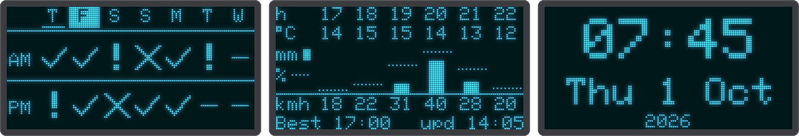
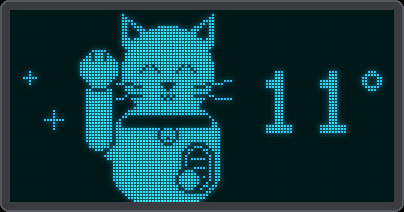

# Clock and lucky cat

Two screens that need no forecast reading. Add them to the tap or long-press list under
[Your own display](screens.md).

## The clock (`clock`)

The time in large digits with a blinking colon, then the weekday and the date, then the year. It needs the
network time and the first weather update (which tells the device its time zone); until then a tap skips
it.

{ .center }

## The lucky cat (`cat`)

A maneki-neko, the beckoning cat of good fortune, with a gold coin in one paw. The other paw beckons about
once a second: it tips towards you, turning its toe beans to you, and back up, while little sparkles
twinkle. The temperature stands beside it.

{ .center }

