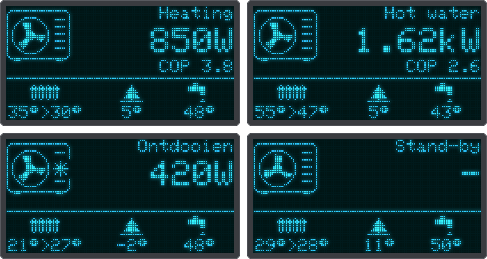
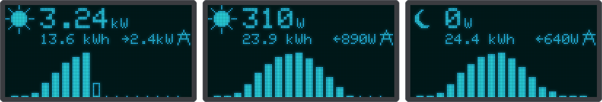
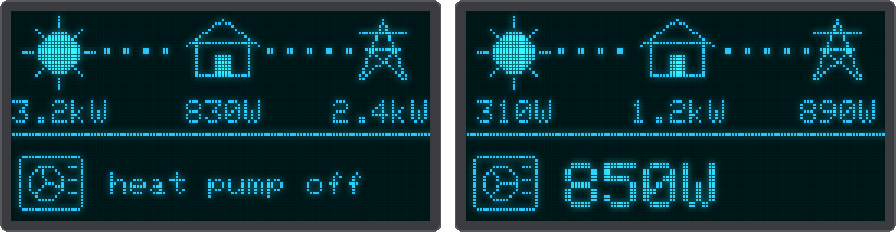
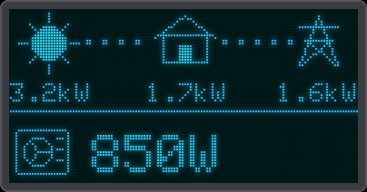
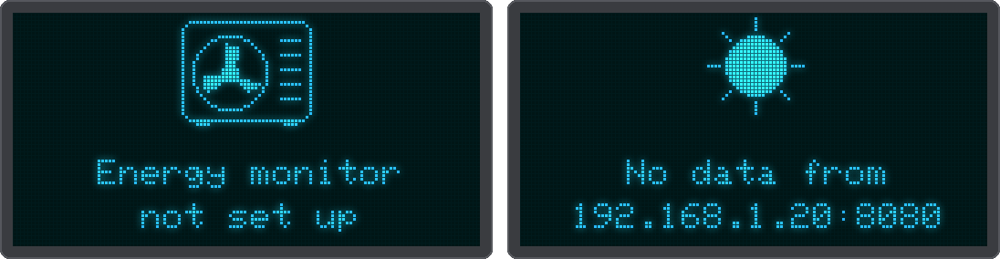

# Heat pump and solar

Three screens show what your heat pump and solar panels are doing right now. The display does not talk to the
heat pump or the inverter itself: something on your own network that already reads them, such as a Raspberry
Pi, serves one small JSON document, and the display reads it over plain HTTP.

- **`heatpump`:** the outdoor unit (its fan turns while it runs, a snowflake while it defrosts), what it is
  doing, the power it uses and its COP; along the bottom the flow and return temperature, the outside
  temperature and the hot water.
- **`solar`:** the power of the panels now, what they made today, what goes to the grid (→) or comes from it
  (←), and a bar for every hour from 05:00 to 21:00; the hour now is an outline, it is still counting.
- **`energy`:** the flow at a glance, from the sun to the house and between the house and the grid, with dots
  running the way the power goes, and the heat pump's power underneath.

{ .center }

{ .center }

{ .center }

{ .center }

## Setting it up

1. Make the JSON document below available at an address on your network, for example
   `http://192.168.1.20/energy.json`. Plain `http://`: the display cannot do https. Use the Pi's IP address
   (give it a fixed one in your router): the display cannot look up a `.local` name.
2. In the web UI, under *Energy monitor*, fill in that address and save.
3. Add `heatpump`, `solar` or `energy` to a [screen list](screens.md).

The display reads the document every 15 seconds while one of these screens is shown, and not at all
otherwise (after a failed read it waits 30 seconds). When it has had no answer for 3 minutes, the screens say
so, with the address they try; without an address they say the energy monitor is not set up. *Last read* on the
card in the web UI says how long ago it worked, or what went wrong. The words on the screens follow
*Language* under *Display*, the temperatures *Units*.

{ .center }

## The JSON document

```json
{
  "heatpump": {
    "mode": "heating",
    "powerW": 850,
    "cop": 3.8,
    "flowC": 35.2,
    "returnC": 30.1,
    "outsideC": 4.5,
    "hotWaterC": 48.2
  },
  "solar": {
    "powerW": 3240,
    "todayWh": 14800,
    "hourlyWh": [0, 0, 0, 0, 0, 0, 80, 420, 1100, 1900, 2600, 3100, 3350, 1080,
                 0, 0, 0, 0, 0, 0, 0, 0, 0, 0]
  },
  "grid": { "powerW": -2410 },
  "house": { "powerW": 830 }
}
```

Every field is optional: what is missing shows as a dash, and a part you do not have (no heat pump, no panels)
can be left out altogether. Numbers may be whole or have decimals.

| Field | Unit | Meaning |
|-------|------|---------|
| `heatpump.mode` | | `heating`, `hotwater`, `cooling`, `defrost`, `standby` or `off`. Another word is shown as it is (up to 11 letters). The fan turns in every mode but `standby` and `off`. |
| `heatpump.powerW` | W | The electrical power the heat pump uses now. |
| `heatpump.cop` | | The COP now: heat out divided by electricity in. Leave it out while it does not run. |
| `heatpump.flowC`, `returnC` | °C | The water to and from the heating. |
| `heatpump.outsideC` | °C | Outside, as the heat pump measures it. |
| `heatpump.hotWaterC` | °C | The hot water tank. |
| `solar.powerW` | W | What the panels make now. |
| `solar.todayWh` | Wh | What they made today. |
| `solar.hourlyWh` | Wh | 24 numbers, one for every hour of today: `[0]` is 00:00 to 01:00. The hour now counts what it made so far; the hours to come are 0. Without it the screen leaves the bars out. |
| `grid.powerW` | W | Positive: coming from the grid. Negative: going to the grid. |
| `house.powerW` | W | What the whole house uses now, heat pump included. Without it the display works it out as solar plus grid. |

Keep the document small (under 2 KB) and quick: the display waits at most 2 seconds for it.

## A minimal server on the Pi

If what reads the heat pump and the inverter can write the document to a file, any web server can serve it.
Without one, this Python script (no packages needed) serves `/home/pi/energy.json` on port 8080, so the address
becomes `http://<the Pi's IP address>:8080/energy.json`:

```python
from http.server import HTTPServer, SimpleHTTPRequestHandler
import functools

handler = functools.partial(SimpleHTTPRequestHandler, directory="/home/pi")
HTTPServer(("", 8080), handler).serve_forever()
```

Write the file in one go (write a temporary file, then rename it over `energy.json`), so the display never
reads half a document.
