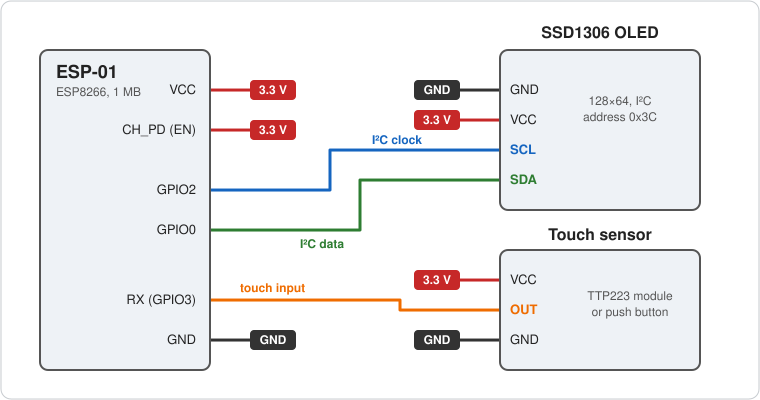

# Hardware

Dayspeck needs three things: an ESP8266, a 0.96" SSD1306 OLED and, if you like, one input to tap. This page
lists the boards it is meant for, what you need, how to wire it and what to watch out for.

## Available hardware

| Option | Input | Status |
|--------|-------|--------|
| [Bare ESP-01 + OLED](#bare-esp-01) | a TTP223 touch module or a push button you add | the reference build, wiring below |
| [HU-061 weather clock kit](#hu-061-weather-clock-kit) | a switch already wired to the RX pin | the same pin the firmware reads, so it should work without wiring |
| [Mini weather clock kit without a switch](#mini-weather-clock-kit-without-a-switch) | none; add a touch sensor | the same chip family and display |

!!! note "Kits are untested"
    The kits are cheap DIY soldering kits (an ESP8266 board, a 0.96" OLED and an acrylic case, a few euros
    on AliExpress). They use the same chip family and the same kind of display as the reference build, but
    **they have not been tried with this firmware yet**. Check the points under
    [checking a kit](#checking-a-kit) before you flash one, and please report what you find.

### Bare ESP-01

The reference build: an ESP-01 (ESP8266, 1 MB flash), an SSD1306 OLED module and a 3.3 V supply, wired as
under [wiring](#wiring). Add a TTP223 touch module or a push button, or leave the input out and let the
screens [cycle by themselves](screens.md#without-a-touch-sensor).

### HU-061 weather clock kit

[HU-061 on AliExpress](https://nl.aliexpress.com/item/1005010184314128.html). This kit has a switch that is
already connected to the RX pin (GPIO3), which is the pin Dayspeck reads for taps and long presses. That
makes it the easiest start: no touch module to add.

- Leave `TOUCH_ACTIVE_HIGH` at its default `0` if the switch pulls RX to ground when pressed (the usual
  wiring); set it to `1` if the switch pulls RX high. See [touch polarity](#touch-polarity).
- Check the OLED address and the SDA and SCL pins (see below).
- RX is shared with the UART, so serial flashing needs the switch released and any serial adapter wired
  correctly. See [build and flash](build.md).

### Mini weather clock kit without a switch

[Kit on AliExpress](https://nl.aliexpress.com/item/1005008473872550.html). This one has no switch. You can
still use it:

- **Add a touch sensor.** A TTP223 touch module on RX (GPIO3) works well behind the acrylic case, and
  needs no hole in it. Wire it as in [wiring](#wiring) and set `TOUCH_ACTIVE_HIGH 1`.
- **Or add a momentary switch** between RX and GND.
- **Or use no input at all.** Switch the touch sensor off in the [web UI](web-ui.md) and let the screens
  [cycle by themselves](screens.md#without-a-touch-sensor).

### Checking a kit

- The display is an SSD1306 at address `0x3C`. Some 0.96" modules use an SH1106 or a different address.
- Which GPIOs the OLED and the input use: set `OLED_SDA`, `OLED_SCL` and `TOUCH_PIN` in
  `firmware/include/config.h`.
- The flash size: the `esp01_1m` environment assumes 1 MB, so a board with 4 MB (NodeMCU, ESP-12F) needs its
  own environment in `platformio.ini` (`board = esp12e` or `nodemcuv2`).

## Parts

| Part | Notes |
|------|-------|
| ESP-01 (ESP8266, 1 MB flash) | the `esp01_1m` board in PlatformIO |
| SSD1306 128×64 I²C OLED, address `0x3C` | |
| Input (optional) | a TTP223 touch module or a push button; without one, switch it off in the web UI |
| 3.3 V supply, ≥ 300 mA | the ESP8266 draws current spikes when transmitting |

## Wiring

Everything runs on 3.3 V. Do not connect the ESP-01 to 5 V.

{ .center }

| ESP-01 pin | Connects to |
|-----------|-------------|
| VCC | 3.3 V supply, OLED **VCC** and touch sensor **VCC** |
| CH_PD (EN) | 3.3 V (the module stays off without it) |
| GND | ground, OLED **GND** and touch sensor **GND** |
| GPIO0 | OLED **SDA** |
| GPIO2 | OLED **SCL** |
| RX (GPIO3) | touch sensor **OUT** |

The ESP-01's TX and RST pins stay unconnected. With a push button instead of a touch module, connect one
side to RX (GPIO3) and the other to GND (no VCC needed).

## Notes

### Touch polarity

Set in `firmware/include/config.h`. `TOUCH_ACTIVE_HIGH 0` (default) expects the pin to be pulled **low**
when pressed (a button to ground, internal pull-up). Set it to `1` for modules such as the TTP223 that
drive the pin **high**.

### Boot pins

GPIO0 and GPIO2 are boot-strap pins and must be **high at power-up**. The OLED's I²C pull-ups normally do
that; do not hold either low.

### The blue LED on an ESP-01S

On an **ESP-01S** the blue LED sits on GPIO2, the OLED's SCL: it flickers whenever the screen is updated.
That is normal while something moves (rain, leaves, the time-lapse, the clock); the firmware only sends a
frame when it differs from the one on the screen, so a still picture keeps the LED dark.

### Serial and the RX pin

GPIO3 is the UART RX pin, so **serial output and serial flashing are unavailable while the input is
attached**. All diagnostics go to the log in the web UI instead. Disconnect the sensor while flashing over
serial.
